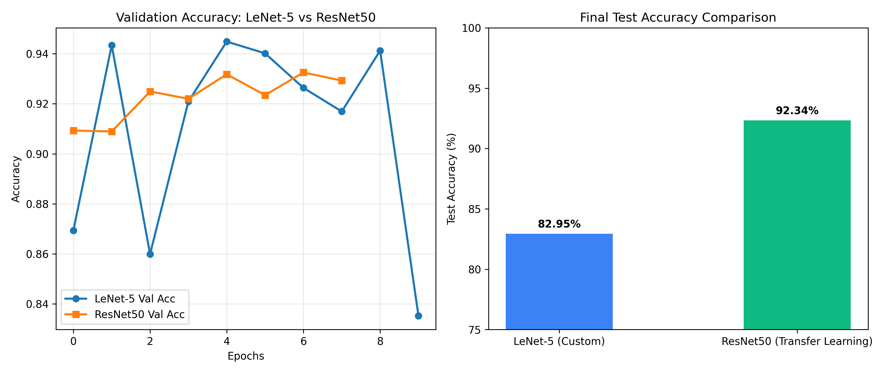

# 🦟 MalariaAI — Deep-Learning Malaria Detection from Blood Cell Microscopy

> **B.Tech CSE Minor Project**
> AI-powered diagnostic tool that classifies Giemsa-stained thin blood smear cell images as **Parasitized** or **Uninfected** using a fine-tuned **MobileNetV2** convolutional neural network.



---

## 📋 Project Overview

Malaria remains one of the deadliest infectious diseases worldwide. Manual microscopic examination of blood smears is the gold standard for diagnosis but is time-consuming and requires trained microscopists. This project automates that process using deep learning.

**Key Features**

- 🔬 Upload a single blood-cell microscopy image and receive an instant AI diagnosis
- 🧠 MobileNetV2 backbone (ImageNet pre-trained, fine-tuned on malaria cells)
- 📊 Side-by-side comparison of 3 architectures (LeNet-5, ResNet50, MobileNetV2)
- 🖥️ Dark-mode clinical dashboard built with Flask + Tailwind CSS
- ⚡ Real-time inference with confidence score, sigmoid output, and latency

---

## 🗂️ Dataset Details

| Property | Value |
|---|---|
| **Source** | NIH National Library of Medicine (NLM) Malaria Dataset |
| **Total Images** | 27,558 cell images |
| **Classes** | Parasitized (malaria-infected) · Uninfected (healthy RBC) |
| **Train / Val / Test Split** | 80 % / 10 % / 10 % |
| **Image Pipeline** | Resized to **64 × 64 RGB**, normalized to `[0, 1]` |
| **Source Link** | [NIH Malaria Dataset](https://lhncbc.nlm.nih.gov/LHC-downloads/downloads.html#malaria-datasets) |

---

## 🏗️ Architecture Comparison

Three architectures were trained and evaluated on the same dataset split:

| # | Architecture | Type | Test Accuracy | Test Loss | Params |
|---|---|---|---|---|---|
| 🏆 1 | **MobileNetV2** | Transfer Learning (Depthwise Separable Conv) | **94.45 %** | 0.2965 | ~2.2 M |
| 2 | ResNet50 | Transfer Learning (Skip Connections) | 92.34 % | 0.2560 | ~23.5 M |
| 3 | LeNet-5 | Custom Baseline CNN (2-Conv Sequential) | 82.95 % | 0.3704 | ~1.1 M |

**MobileNetV2** was selected as the deployed model due to its superior accuracy and lightweight footprint, making it ideal for resource-constrained environments.

---

## 📁 Project Structure

```
Malaria Detection Minor Proj/
├── app.py                              # Flask backend (model loading + /predict API)
├── malaria_best_model.h5               # Trained MobileNetV2 weights (23.3 MB)
├── architecture_comparison_3models.png # Training curves comparison chart
├── requirements.txt                    # Python dependencies
├── .gitignore                          # Git ignore rules
├── README.md                           # This file
├── templates/
│   └── index.html                      # Dark-mode diagnostic dashboard
├── static/                             # (auto-linked assets)
│   └── architecture_comparison_3models.png
└── sample_test_cells/
    └── sample_test_cells/
        ├── parasitized_cell_1.png
        ├── parasitized_cell_2.png
        ├── uninfected_cell_1.png
        └── uninfected_cell_2.png
```

---

## 🚀 Local Setup & Run

### Prerequisites

- Python 3.9 – 3.11
- pip

### Steps

```bash
# 1. Clone the repository
git clone https://github.com/<your-username>/malaria-detection-minor-project.git
cd malaria-detection-minor-project

# 2. Create a virtual environment
python -m venv venv
source venv/bin/activate        # Linux / macOS
venv\Scripts\activate           # Windows

# 3. Install dependencies
pip install -r requirements.txt

# 4. Run the Flask server
python app.py
```

Open **http://localhost:5000** in your browser. Upload a cell image and click **Run MobileNetV2 Diagnostic Inference**.

---

## 🔌 API Reference

### `POST /predict`

| Parameter | Type | Description |
|---|---|---|
| `file` | `multipart/form-data` | Blood cell image (PNG / JPG / BMP) |

**Response (JSON)**

```json
{
  "prediction": "Parasitized (Malaria Detected)",
  "is_parasitized": true,
  "confidence": 97.83,
  "raw_sigmoid": 0.021741,
  "inference_ms": 48.52
}
```

---

## 🛠️ Technology Stack

| Layer | Technology |
|---|---|
| **Deep Learning** | TensorFlow / Keras, MobileNetV2 |
| **Backend** | Flask, Gunicorn |
| **Frontend** | HTML5, Tailwind CSS, Vanilla JS |
| **Image Processing** | Pillow, NumPy |
| **Language** | Python 3 |

---

## 📜 License

This project is developed as part of an academic Minor Project for B.Tech CSE.

---

<p align="center">
  <b>MalariaAI</b> — Fighting malaria, one cell at a time. 🔬
</p>
